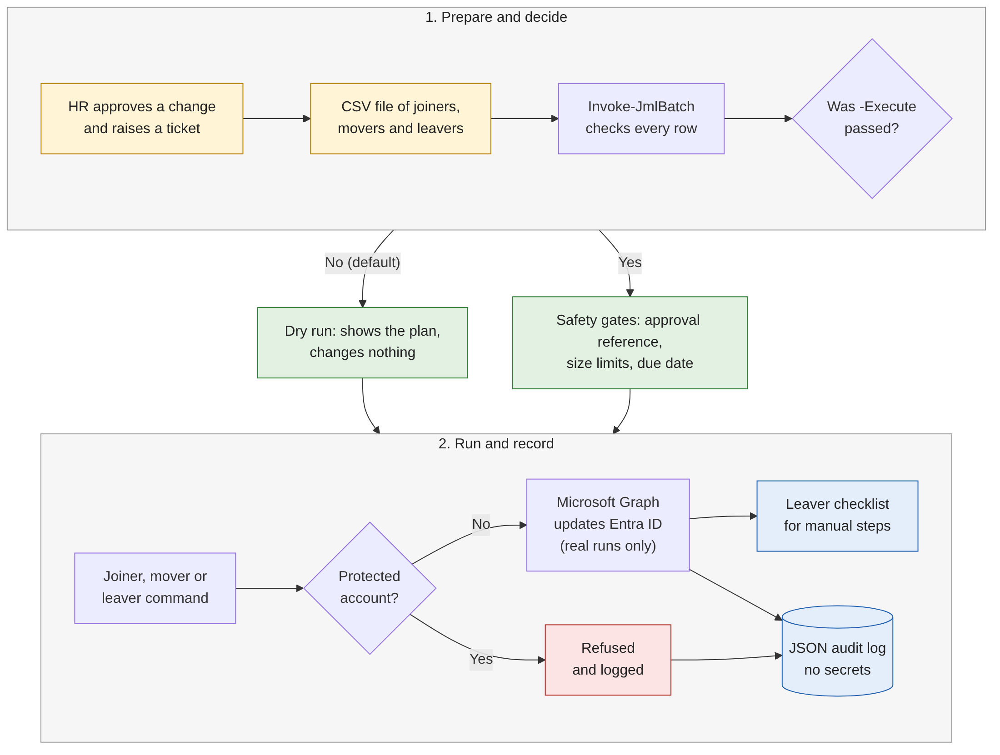

# Joiner Mover Leaver Automation for Microsoft Entra ID

[](https://github.com/pJijesh/joiner-mover-leaver-automation/actions/workflows/ci.yml) [](LICENSE) [](https://learn.microsoft.com/powershell/)

**Problem:** When people join, change role or leave, access is usually changed by hand from emails and spreadsheets. Starters wait for the right access, movers keep access they no longer need, and leavers keep accounts, licences or sessions longer than they should, with no reliable record of who did what.

**For:** IT managers, service desk teams and security reviewers who run Microsoft 365 and Microsoft Entra ID, and the HR and line managers who depend on them. It is also a worked example for anyone assessing how a senior IT person designs safe automation.

**Demonstrates:** A PowerShell 7 module on the Microsoft Graph SDK with four commands driven by CSV and JSON. It runs as a dry run by default, refuses privileged and break-glass accounts, is idempotent, keeps a JSON audit log with no secrets, and is covered by 134 Pester tests with Graph mocked (22 of them compare the mocks with the real SDK when it is installed), plus PSScriptAnalyzer, in CI.



More detail for each event is in [docs/process-flow.md](docs/process-flow.md).

## Why it matters

This section is written for HR and managers, in plain English.

* **New starters are ready on day one.** HR sends one row per person. The automation prepares the account a few days before the start date, with the right teams, apps and licence for the department and job title. The same rules apply to everyone, so a new analyst in Finance gets what the last analyst in Finance got.
* **Fewer missed leaver steps.** Every leaver follows the same sequence: sign-in blocked, active sessions ended, group access removed, licences released. Steps that only a person can do (the mailbox, files, laptop, other systems) are written into a checklist for the manager and IT, so nothing depends on memory.
* **Role changes do not leave old access behind.** When someone moves from Finance to Sales, the Finance access goes and the Sales access arrives. Access that was granted by hand elsewhere is left alone, so the automation does not break things it does not own.
* **A trail that auditors can read.** Every action, including practice runs, is recorded with who ran it, when, under which HR approval reference, and what happened. Passwords are never written down.
* **Safe to try.** Nothing changes until someone deliberately asks for a live run. The preview shows exactly what would happen, so HR and the manager can check it first.
* **Emergency and administrator accounts are protected.** The automation refuses to touch them, so a mistake in a spreadsheet cannot lock the organisation out.

HR guidance, including what to send and when, is in [docs/hr-guide.md](docs/hr-guide.md).

## Quick start

You need PowerShell 7.2 or later and the Microsoft Graph PowerShell SDK. The tests need neither a tenant nor the SDK. Try this in a test tenant first.

```powershell
# 1. Install the SDK modules the commands use
Install-Module Microsoft.Graph.Authentication, Microsoft.Graph.Users, Microsoft.Graph.Users.Actions, `
    Microsoft.Graph.Groups, Microsoft.Graph.Identity.SignIns -Scope CurrentUser

# 2. Load the module and sign in with only the permissions a joiner needs
Import-Module ./src/JmlAutomation/JmlAutomation.psd1
Connect-JmlGraph -Operation Joiner

# 3. Preview one joiner. -WhatIf lists every action and changes nothing
New-JmlJoiner -EmployeeId NW1001 -GivenName Alex -Surname Morgan -Department Finance `
    -JobTitle 'Finance Analyst' -ManagerUserPrincipalName sam.rivera@northwind.example `
    -UsageLocation GB -ApprovalReference HR-1001 -WhatIf

# 4. Preview a whole file. This is a dry run, because -Execute is not passed
Connect-JmlGraph -Operation All
Invoke-JmlBatch -Path ./samples/events.sample.csv -AsOfDate 2026-12-01

# 5. After the preview has been checked and approved, apply it for real
Invoke-JmlBatch -Path ./samples/events.sample.csv -AsOfDate 2026-12-01 -Execute
```

The sample files describe invented people at `northwind.example`. To try them, create matching users and groups in a test tenant, or edit the CSV and the files in `config/` to match it.

Before the first live run, edit the files in `config/` for your organisation: the domain and naming rules, the department to group mapping, the licence groups, and above all the list of protected accounts.

To run the checks yourself:

```powershell
Install-Module Pester -MinimumVersion 5.5.0 -MaximumVersion 5.99.99 -Scope CurrentUser
Install-Module PSScriptAnalyzer -Scope CurrentUser
./scripts/Invoke-Checks.ps1
```

## Commands

| Command | What it does | Dry run |
|---|---|---|
| `Connect-JmlGraph` | Signs in to Microsoft Graph with the least permissions for `Joiner`, `Mover`, `Leaver` or `All`. Supports interactive, device code and certificate (app-only) sign-in. | Not applicable |
| `New-JmlJoiner` | Creates the account from an HR record, sets manager, department, title and location, adds baseline, department, role and licence groups, and returns a random one-time password as a `SecureString`. Re-running repairs rather than duplicates. | `-WhatIf` |
| `Move-JmlUser` | Applies a change of department, job title, manager or office. Adds the new access first, then removes the old role's access. Only touches groups named in the configuration. | `-WhatIf` |
| `Remove-JmlLeaver` | Blocks sign-in, revokes sessions, removes registered authentication methods and group access, holds licences until the mailbox is converted, then writes a checklist for the manual steps. Never deletes the account. | `-WhatIf` |
| `Invoke-JmlBatch` | Reads a CSV of joiner, mover and leaver rows, validates every row, applies size limits and approval references, defers future-dated rows, and writes a summary file. | On by default. Pass `-Execute` to apply. |

CSV columns: `EventType, EffectiveDate, ApprovalReference, EmployeeId, UserPrincipalName, GivenName, Surname, Department, JobTitle, ManagerUpn, UsageLocation, OfficeLocation, MailboxConverted`. See [samples](samples/README.md).

## Security statement

* **No secrets in the repository.** All data is synthetic. Tenant IDs, certificate thumbprints and credentials are supplied at run time. A test scans the repository for real organisation names, non-example email domains and secret-like strings.
* **Dry run first, live run on purpose.** Batch runs change nothing without `-Execute`. Each command supports `-WhatIf`.
* **Least privilege.** Each operation requests only its own Graph permissions. Role-assignable groups and administrator roles are out of scope by design. See [docs/permissions.md](docs/permissions.md).
* **Protected accounts are refused.** Break-glass, service and administrator accounts, Entra role holders, members of protected groups and on-premises synced accounts are not modified.
* **Approval and limits.** A live row needs an approval reference. Oversized files are refused before any change.
* **Audit log.** One JSON line per action with the actor, time, run ID, approval reference and result. Secret-looking values are redacted. If the log cannot be written, a live run stops.
* **One-time passwords** come from the operating system's cryptographic random generator, are forced to change at first sign-in, and are never logged.

Details and known gaps are in [docs/security-considerations.md](docs/security-considerations.md).

## Repository map

```text
.
├── src/JmlAutomation/        PowerShell module (Public commands, Private helpers)
├── config/                   Naming, department groups, licences, protected accounts, settings (JSON)
├── samples/                  Synthetic CSV files for joiners, movers, leavers and a mixed batch
├── tests/                    Pester 5 tests, with Graph mocked by an in-memory tenant
├── scripts/Invoke-Checks.ps1 Runs PSScriptAnalyzer and Pester, as CI does
├── docs/
│   ├── process-flow.md       Diagrams of the process, with PNG renderings
│   ├── hr-guide.md           What HR provides, timelines and checklists
│   ├── security-considerations.md
│   ├── permissions.md        Graph permissions and Entra roles, and why
│   └── testing-status.md     Exactly what was and was not run
└── .github/workflows/ci.yml  PowerShell 7 on Ubuntu: PSScriptAnalyzer and Pester
```

## Limitations

* **Not yet proven against a live tenant.** The tests mock Microsoft Graph. Run in a test tenant first. [docs/testing-status.md](docs/testing-status.md) lists exactly what has and has not been run.
* **Cloud-only, group-based model.** Access is controlled through security groups, and licences through group-based licensing. Accounts synced from on-premises Active Directory are refused, not handled.
* **Some leaver steps cannot be done through Graph.** Converting the mailbox to a shared mailbox, OneDrive access, device retirement and third-party applications are in the checklist as manual steps.
* **Distribution lists, dynamic groups and role-assignable groups are skipped** and reported, not changed.
* **The tool cannot check who approved a CSV.** It records the approval reference. Use your change process for the approval itself.
* **Already-issued access tokens** can remain valid for a short time after sign-in is blocked, unless the application supports continuous access evaluation.
* **Not a replacement for an HR-driven provisioning product.** It reads a CSV, not an HR system API. It suits small and mid-sized teams, or as a safe core to build on.

## Roadmap

Planned, not promised. Order and timing change with other work.

- **Next:** Run a pilot in a test tenant and record the results; Add manager notification templates
- **Then:** Add sample HR export mappings; Add mailbox and file handover step for leavers
- **Later:** Add access review hook for movers; Release v1.1

## Author

Built by Puliyappottammal Jijesh, an IT manager. [LinkedIn](https://www.linkedin.com/in/pjijesh) | [GitHub](https://github.com/pJijesh)

## Licence

MIT. See [LICENSE](LICENSE).
