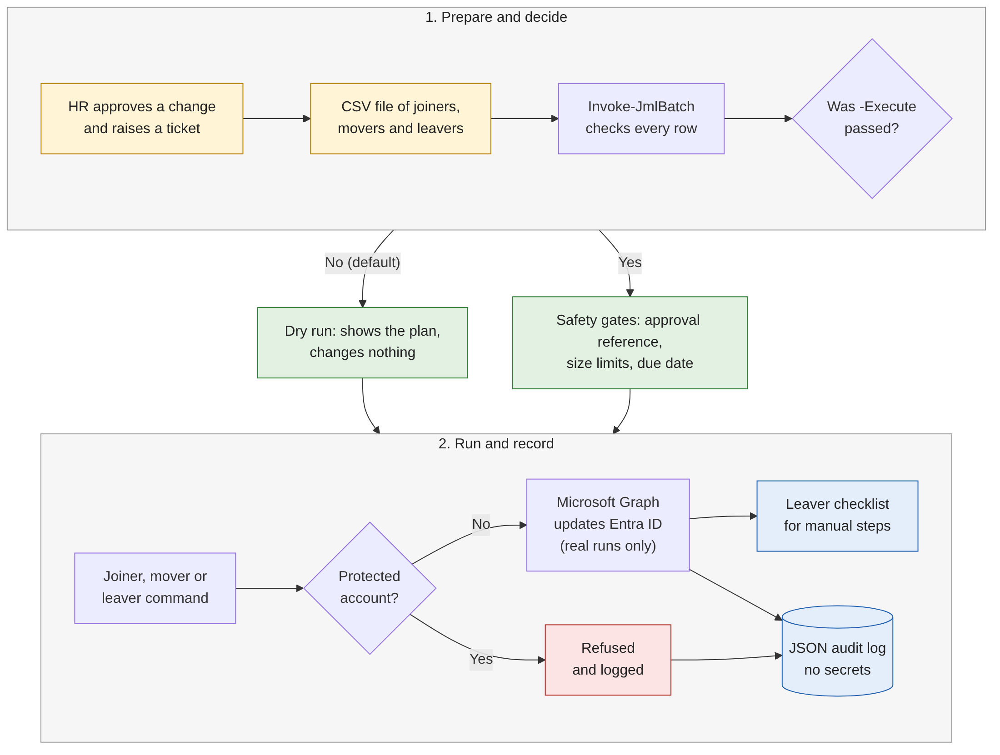
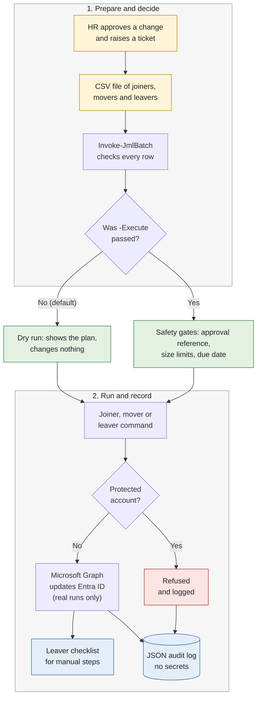
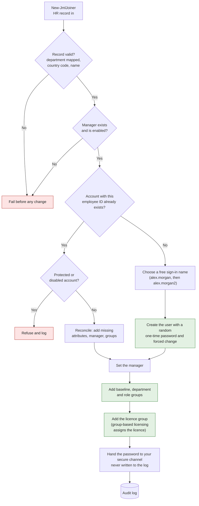
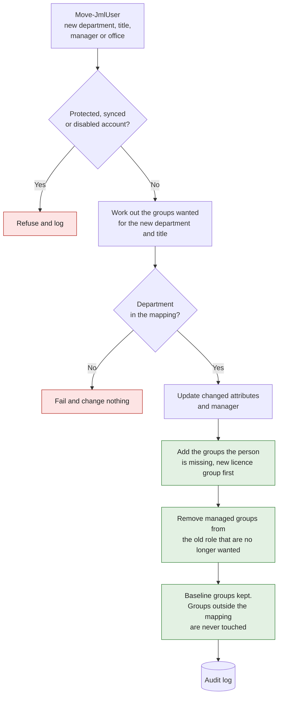
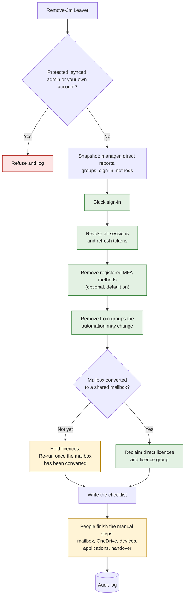

# Process flow

These diagrams show what each command does, in the order it does it. Each diagram is a picture for quick reading, and the Mermaid source below it renders on GitHub and can be edited.

All four diagrams describe the same rule: **nothing changes in the directory unless a person asked for a live run**, and **every run, planned or real, leaves an audit record**.

## 1. The whole process



Reading the diagram:

* HR is the source of truth. The automation never decides who joins, moves or leaves. It carries out an approved change.
* The default is a dry run. A live run needs the explicit `-Execute` switch.
* Protected accounts (break-glass, administrators, accounts synced from on-premises Active Directory, the account running the tool) are refused at the worker level, so the same protection applies however the command is started.



## 2. Joiner


The joiner command is safe to run twice. If an account with the same employee ID already exists, it is reconciled instead of recreated. A disabled account is never re-enabled automatically, because a re-hire needs a person to review it.



## 3. Mover


Only groups named in `config/department-groups.json` and `config/licences.json` are ever added or removed. Access granted by hand elsewhere is left alone. The new licence group is added before the old one is removed, so licensing never has a gap.



## 4. Leaver


The account is never deleted by this tool. Sign-in is blocked and sessions are revoked first, because that is the step that actually stops access. Licences are held back until the mailbox has been converted to a shared mailbox, because an unlicensed mailbox cannot be converted and would be lost after the grace period. The checklist lists the steps that Microsoft Graph cannot do.



## Regenerating the pictures

The PNG files are rendered from the Mermaid blocks above with the Mermaid command line tool (`mmdc`). On a Linux machine that runs as root, Chromium needs a small configuration file:

```json
{ "args": ["--no-sandbox", "--disable-setuid-sandbox"] }
```

```text
mmdc -p puppeteer.json -i diagram.mmd -o process-flow.png -b white -w 1400 -s 2
```
